# CryptoMap

### Enterprise Cryptographic Intelligence and Post-Quantum Readiness Platform

**Discover. Assess. Visualize. Modernize.**

CryptoMap is a local-first cybersecurity application for teams that need an evidence-backed view of cryptographic assets. It analyzes only files explicitly uploaded or authorized for review, builds a workspace-scoped inventory, highlights weak or deprecated cryptography, parses X.509 certificate metadata, maps recorded dependencies, and helps plan post-quantum cryptography (PQC) modernization.

> CryptoMap is designed for authorized defensive analysis. It does not perform network scanning, execute uploaded files, extract private keys, or modify production systems.

## Highlights

- **Safe file analysis** for PEM, CRT, CER, JSON, YAML, TXT, CONF, and CONFIG inputs.
- **X.509 certificate intelligence** for subject, issuer, validity period, key type, key size, and signature algorithm evidence.
- **Transparent crypto policy rules** that label weak, deprecated, accepted, configuration-dependent, and quantum-relevant cryptography.
- **Evidence-only dependency graph** that never invents undocumented relationships.
- **PQC readiness score** that supports modernization planning without claiming certification.
- **Migration planner** with persisted task status updates.
- **Security reporting** with downloadable PDF executive summaries and CSV findings exports.
- **Audit-backed local workspace** with persisted assets, findings, dependencies, migration tasks, and events.
- **Premium command-center UI** built for fast security review, with responsive layouts and clear synthetic-demo labels.

## Product Screens

> The screenshots below show the built-in **Synthetic Demo Workspace**. They illustrate the product workflow only and do not represent customer systems or live infrastructure.

<table>
  <tr>
    <td width="50%" valign="top">
      <strong>Security Overview</strong><br />
      Workspace metrics, algorithm and risk distributions, prioritized actions, and recent discoveries.
      <br /><br />
      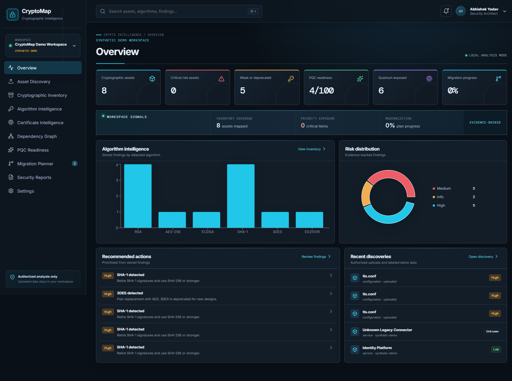
    </td>
    <td width="50%" valign="top">
      <strong>Authorized Asset Discovery</strong><br />
      Explicit upload boundary with supported file types and defensive-analysis safeguards.
      <br /><br />
      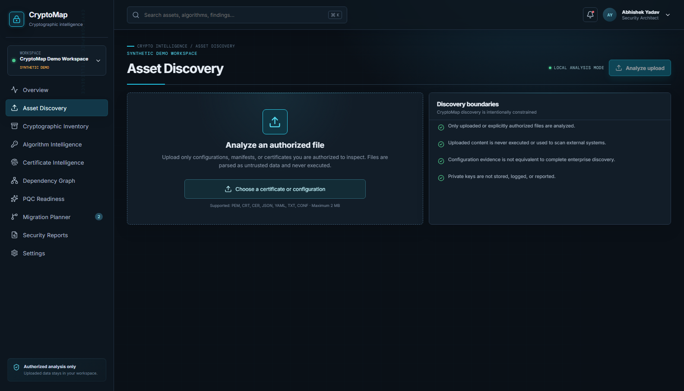
    </td>
  </tr>
  <tr>
    <td width="50%" valign="top">
      <strong>PQC Readiness</strong><br />
      Post-quantum exposure, planning score, NIST references, and next-step guidance.
      <br /><br />
      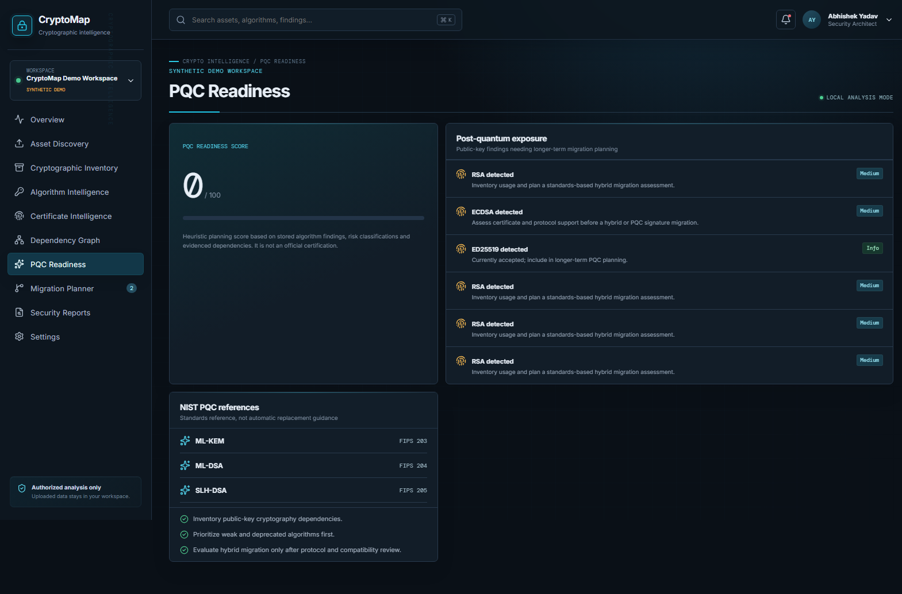
    </td>
    <td width="50%" valign="top">
      <strong>Security Reports</strong><br />
      Evidence-backed scope summary with downloadable PDF and CSV exports.
      <br /><br />
      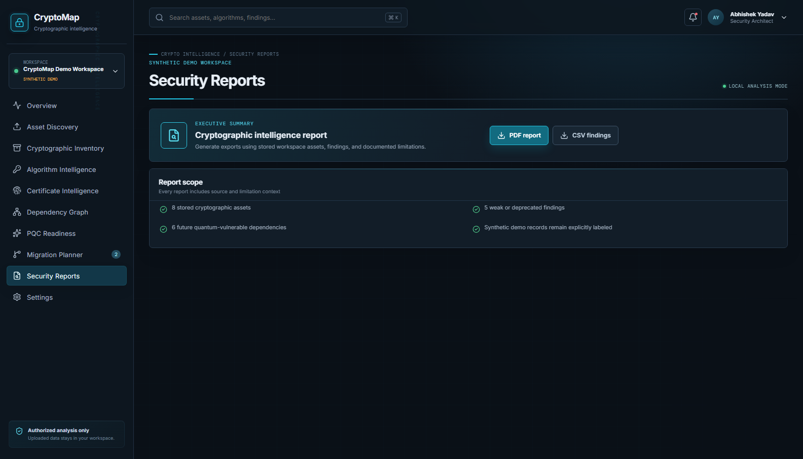
    </td>
  </tr>
  <tr>
    <td width="50%" valign="top">
      <strong>Cryptographic Inventory</strong><br />
      Workspace-scoped asset records with asset type, evidence source, assessed risk, and discovery time.
      <br /><br />
      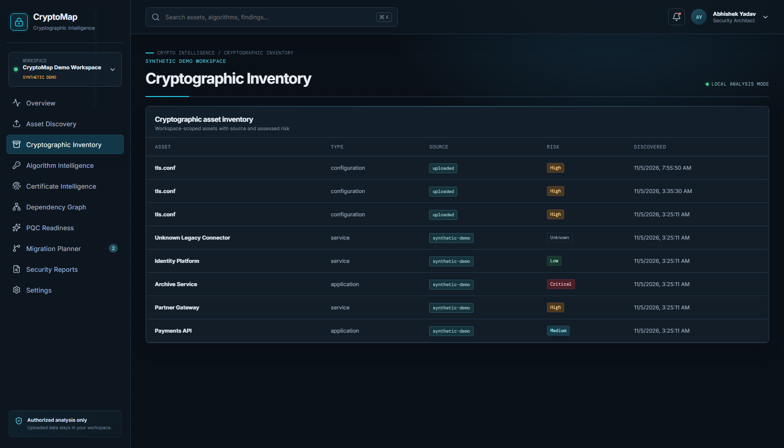
    </td>
    <td width="50%" valign="top">
      <strong>Algorithm Intelligence</strong><br />
      Rule-level evidence, risk classification, quantum relevance, and a recommended action for every finding.
      <br /><br />
      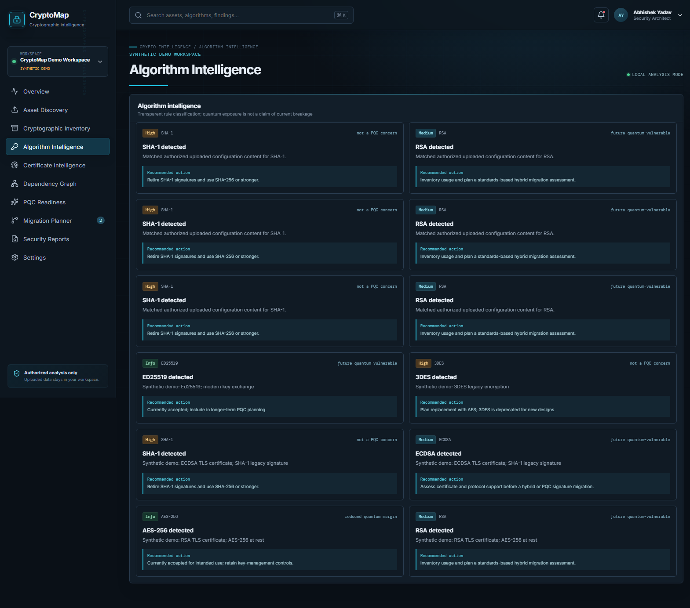
    </td>
  </tr>
  <tr>
    <td width="50%" valign="top">
      <strong>Certificate Intelligence</strong><br />
      Certificate-specific inspection results derived from the authorized evidence in the workspace.
      <br /><br />
      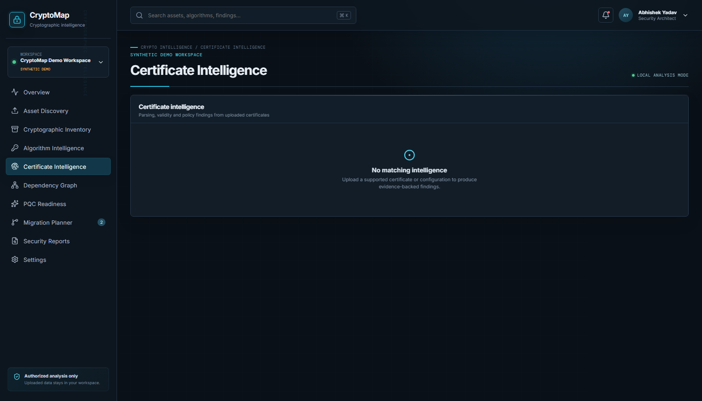
    </td>
    <td width="50%" valign="top">
      <strong>Dependency Graph</strong><br />
      Visual relationships between stored assets, limited to documented and evidenced dependencies.
      <br /><br />
      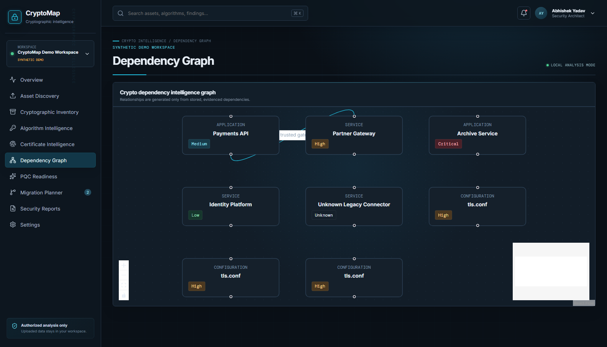
    </td>
  </tr>
  <tr>
    <td width="50%" valign="top">
      <strong>Migration Planner</strong><br />
      Persisted modernization tasks with priority, current lifecycle status, and migration direction.
      <br /><br />
      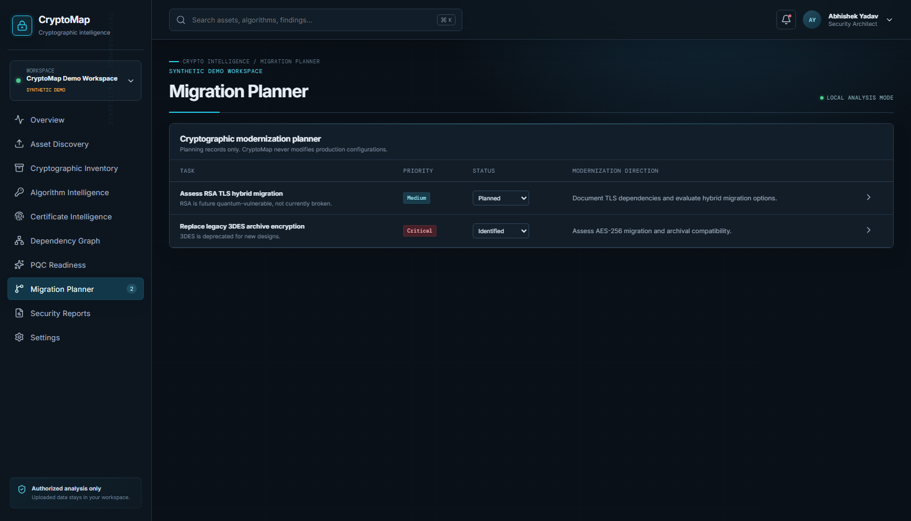
    </td>
    <td width="50%" valign="top">
      <strong>Workspace Settings</strong><br />
      Local development and data-boundary configuration, including explicit synthetic-demo labeling.
      <br /><br />
      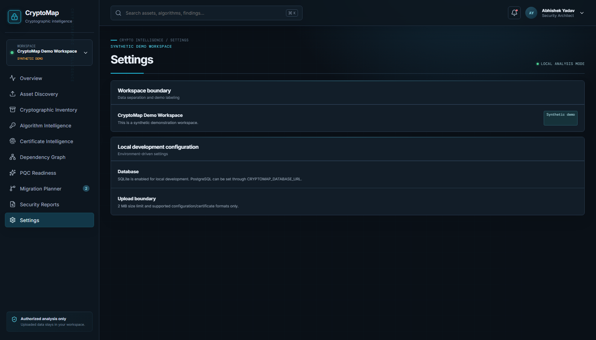
    </td>
  </tr>
</table>

## Product Workflow

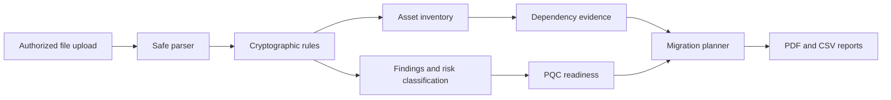

## Architecture

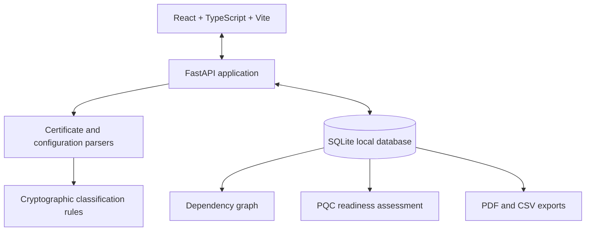

## Feature Map

| Area | Capability |
| --- | --- |
| Dashboard | Asset, critical-risk, weakness, PQC, quantum-exposure, and migration metrics |
| Asset Discovery | Size-limited and format-allowlisted uploads for authorized evidence |
| Crypto Inventory | Workspace-scoped asset record, source, discovery time, and assessed risk |
| Algorithm Intelligence | Rule explanation, evidence, risk level, quantum relevance, and recommendation |
| Certificate Intelligence | X.509 metadata and certificate-specific findings |
| Dependency Graph | Visualizes persisted relationships only |
| PQC Readiness | Planning score, exposure list, NIST references, and next steps |
| Migration Planner | Persisted modernization tasks and lifecycle status |
| Security Reports | Downloadable executive PDF and findings CSV |
| Audit API | Persisted activity records for workspace events |

## Technology Stack

| Layer | Technologies |
| --- | --- |
| Frontend | React 19, TypeScript, Vite, React Flow, Recharts, Lucide, Framer Motion |
| Backend | Python, FastAPI, Pydantic, SQLAlchemy |
| Cryptography | `cryptography`, PEM/DER and X.509-compatible certificate parsing |
| Data | SQLite by default, PostgreSQL connection URL supported through environment configuration |
| Reporting | ReportLab PDF export and CSV export |
| Testing | Pytest, HTTPX test client |

## Repository Layout

```text
CRYPTOMAP/
|-- backend/
|   |-- app/
|   |   |-- analyzers/       # Analysis extension points
|   |   |-- core/            # Environment configuration
|   |   |-- database/        # SQLAlchemy session setup
|   |   |-- models/          # Persisted workspace records
|   |   |-- parsers/         # Safe certificate/config parsers
|   |   |-- rules/           # Deterministic classification rules
|   |   `-- services/        # Synthetic demo seed service
|   `-- tests/
|-- frontend/
|   `-- src/                 # React application and premium UI theme
|-- sample-data/
|   `-- legacy-crypto-example.conf
|-- .env.example
`-- README.md
```

## Quick Start

### Prerequisites

- Python 3.11 or later
- Node.js 20 or later
- npm

### 1. Start the backend

```powershell
cd backend
py -3 -m venv .venv
.\.venv\Scripts\python.exe -m pip install -r requirements.txt
.\.venv\Scripts\uvicorn.exe app.main:app --reload --port 8000
```

The API will be available at `http://127.0.0.1:8000`.

- Interactive API documentation: `http://127.0.0.1:8000/docs`
- Health check: `http://127.0.0.1:8000/api/v1/health`

### 2. Start the frontend

Open a second terminal:

```powershell
cd frontend
npm install
npm run dev
```

Open the address shown by Vite, normally `http://127.0.0.1:5173`.

### 3. Try the authorized-analysis flow

1. Open **Asset Discovery**.
2. Choose `sample-data/legacy-crypto-example.conf`.
3. Start the analysis.
4. Review Inventory, Algorithm Intelligence, PQC Readiness, Dependency Graph, and Migration Planner.
5. Export the PDF summary or CSV findings from **Security Reports**.

## Configuration

Copy the project environment template and update only values appropriate for your environment.

| Variable | Purpose | Default |
| --- | --- | --- |
| `CRYPTOMAP_DATABASE_URL` | SQLAlchemy database URL | Local SQLite database in `backend/cryptomap.db` |
| `CRYPTOMAP_MAX_UPLOAD_BYTES` | Maximum authorized upload size | `2097152` (2 MB) |
| `CRYPTOMAP_CORS_ORIGINS` | Comma-separated allowed frontend origins | `http://127.0.0.1:5173,http://localhost:5173` |
| `VITE_API_URL` | Frontend API base URL | `http://127.0.0.1:8000` |

## API Surface

| Method | Endpoint | Description |
| --- | --- | --- |
| `GET` | `/api/v1/health` | Service health check |
| `GET` | `/api/v1/workspaces` | Available workspaces |
| `GET` | `/api/v1/dashboard` | Dashboard metrics and distributions |
| `GET` | `/api/v1/assets` | Workspace asset inventory |
| `GET` | `/api/v1/findings` | Evidence-backed findings |
| `POST` | `/api/v1/scans/upload` | Analyze an authorized supported file |
| `GET` | `/api/v1/dependencies` | Persisted dependency evidence |
| `GET` | `/api/v1/pqc` | PQC readiness information |
| `GET` | `/api/v1/migrations` | Migration planning tasks |
| `POST` | `/api/v1/migrations/{task_id}/status` | Update a migration task status |
| `GET` | `/api/v1/audit` | Workspace audit records |
| `GET` | `/api/v1/reports/summary.pdf` | Download executive PDF report |
| `GET` | `/api/v1/reports/findings.csv` | Download findings CSV export |

## Testing and Quality Checks

```powershell
# Backend tests
cd backend
.\.venv\Scripts\python.exe -m pytest -q

# Frontend type check and production build
cd ..\frontend
npm run build
npm run lint
```

The backend test suite covers safe crypto parsing, unsupported-input handling, upload persistence, dashboard data, and report endpoints.

## Synthetic Demo Data

CryptoMap includes a **Synthetic Demo Workspace** so the interface can be evaluated immediately. All seeded records are explicitly marked as synthetic. They represent product behavior and are not customer data, live infrastructure, or a claim of a real-world finding.

Files uploaded through Asset Discovery are recorded independently with their source shown as `uploaded`.

## Security Boundaries and Limitations

- Analyze only content you own or are explicitly authorized to inspect.
- Uploaded input is treated as untrusted data and is never executed.
- Private keys are not stored, logged, or exported.
- Certificate parsing does not establish a complete certificate-chain trust decision.
- The PQC score is a planning heuristic, not a compliance or cryptographic certification.
- Local SQLite storage is suitable for development; production deployment needs hardened database, backup, encryption, retention, and access-control controls.
- The current implementation does not include production SSO/RBAC, live network discovery, or a production immutable audit log.
- CryptoMap creates planning records only; it does not alter cryptographic configuration or systems.

## Roadmap

- PostgreSQL migrations and encrypted production storage
- SSO, RBAC, and workspace membership controls
- Organization-specific crypto policy packs
- Certificate-chain validation and broader file-format support
- Signed or externally anchored audit retention
- Authenticated discovery connectors for explicitly authorized environments

## Author

Designed and developed by **Abhishek Yadav**.
